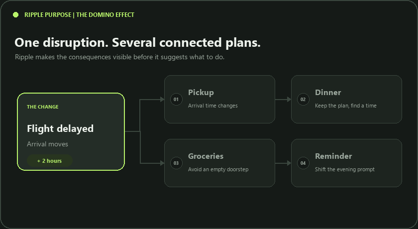
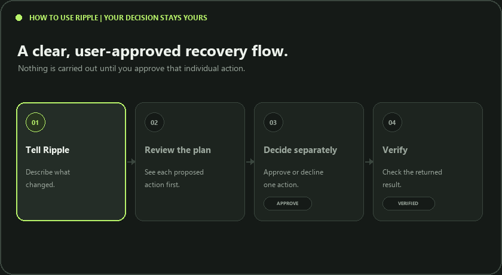

# Ripple

**One problem. Every consequence handled.**

Ripple is a voice-friendly Alexa+ / MCP hackathon simulation for everyday disruptions. Its primary scenario focuses on a late commute putting a school pickup deadline at risk: Ripple compares a pre-confirmed backup contact with a mock ride using arrival estimates, cost, the user's budget, and service availability. Delayed/cancelled flights, late grocery delivery, and an overrun meeting remain available as additional scenarios.

Ripple's core idea is not just to report a disruption: trace which commitments it puts at risk, compare only viable recovery options against the user's constraints, explain the cost-versus-time trade-off, and verify each step the user approves.

The pickup flow is deliberately staged: Ripple gathers context, calls `find_pickup_options` to compare deadline-safe options, lets the user choose one, then prepares a single action for separate approval and verification. The browser discovers and calls a real MCP server over Streamable HTTP using the negotiated MCP protocol version `2025-11-25`.

> **Simulation, not live integrations:** Calendar, travel, transport, delivery, reservations, and messaging are mock services held in server memory. Jordan, the school, and the transport quote are fictional demo data; no real person is contacted, ride is booked, or handoff confirmed. Verification confirms only the simulated message or booking—not that a child was physically collected. Planning uses transparent deterministic rules, not a generative LLM. The pickup delay, deadline, budget, and module availability are editable. Plans reset when the server restarts or when **Reset demo** is selected.

The **MCP Control Room** shows the exact tool catalog returned by `tools/list`, grouped into simulated service modules. Toggle a module offline to see its source data withheld and dependent proposed actions omitted with a visible blocker. This is an availability simulation inside one MCP server, not a connection to separate live services.

## Visual guide

The app includes two short looping GIFs: one explains the domino-effect problem Ripple addresses, and the other demonstrates the user-controlled review and verification flow.





## Run on Windows

Requirements: Python 3.10 or newer.

From this folder in PowerShell:

```powershell
python -m venv .venv
.\.venv\Scripts\Activate.ps1
python -m pip install -r requirements.txt
python server.py
```

Open [http://127.0.0.1:8000/](http://127.0.0.1:8000/). The server and web simulator use the same local process. `requirements.txt` contains the MCP Python SDK; pip installs its required Python dependencies. No LLM, API key, external account, or model download is needed for the demo.

## Run with Docker (optional)

Docker is an alternative to installing Python dependencies locally. From the project folder, build and start the app:

```powershell
docker build -t ripple .
docker run --rm --name ripple -p 8000:8000 ripple
```

Then open [http://127.0.0.1:8000/](http://127.0.0.1:8000/). The container serves both the web app and MCP endpoint from port `8000`. Stop it with **Ctrl+C**; `--rm` removes the stopped container. The demo uses in-memory mock data, so its scenario state resets when the container is restarted.

## Try different scenarios

1. Confirm **MCP · CONNECTED** and that the tool discovery message appears.
2. Start with **Pickup at risk**, or choose **Flight delayed**, **Flight cancelled**, **Delivery late**, or **Meeting overrun**.
3. For pickup, open **Adjust the scenario data** to change the commute delay, pickup deadline, budget, recommendation priority, and mock-module availability. Select **Find safe pickup options**. Ripple calls `prepare_recovery_context` for commute, calendar, constraints, and service availability, then calls `find_pickup_options` to compare the backup contact and mock ride. Choose whether Ripple should prioritize lower cost or a larger arrival buffer. MCP explains its recommendation and quantifies the cost-versus-buffer trade-off between eligible options; you can still select either eligible option yourself. Each option shows its estimated arrival, cost, deadline buffer, and whether its MCP module is available. Late, over-budget, or offline options are disabled.
4. Choose an eligible option and select **Prepare approval request**. Ripple calls `propose_recovery_plan` for only that selected action. Nothing is sent or booked before you approve. For the other scenarios, context gathering and plan generation continue through `prepare_recovery_context` and `propose_recovery_plan` in the existing flow. You can edit the sample request or use **Speak**; scenario selection also follows keywords in typed requests.
5. Compare the additional plans: a flight delay shifts dinner and drafts a pickup note; a cancellation proposes a replacement flight; a late delivery offers a new window and household update; a meeting overrun changes dinner and its reminder. Message actions always wait for your approval.
6. Each proposal has its own **Approve** and **Decline** buttons. Choose either option for one action; Ripple sends that single decision to MCP and immediately calls `verify_action_status`. Declined actions are checked to confirm that no change was made. Pickup verification explicitly says it does not confirm the physical handoff.
7. If the primary delivery provider fails, choose **Find recovery option**. Ripple calls the discovered `find_recovery_options` MCP tool. It offers the backup only if the simulated backup provider is available; the fallback is a new proposal that must be approved and verified separately.
8. Read **Ripple Impact Map** to see which returned service data led to each proposed action. Select **Logs ↗** to inspect the actual MCP tool arguments and results on a separate page.
9. Use **Reset demo** to restore the pickup-risk starting scenario.

The app includes a light/dark appearance toggle. Speech input depends on browser support and its local security requirements; if unavailable, type the sample request instead. The core workflow is usable without speech.

## MCP Logs

Select **Logs ↗** in the app header to open a separate page with the MCP activity feed. Requests and results are saved in browser local storage (up to the latest 200 entries), so the page can show activity from the main Ripple tab and updates while open. Expand an entry to inspect its arguments and response. **Clear logs** removes the saved activity; restarting the server does not clear browser logs.

## MCP tools

| Tool | Purpose |
|---|---|
| `get_user_constraints` | Read protected plans and preferences |
| `get_calendar_events` | Read mock events affected tonight |
| `get_delivery_status` | Check the grocery delivery window |
| `get_travel_status` | Read or update the simulated flight delay |
| `find_alternatives` | Find dinner or delivery alternatives |
| `set_demo_scenario` | Select one of five simulated disruption types |
| `prepare_recovery_context` | Apply editable scenario inputs and return relevant mock service state in one call |
| `find_pickup_options` | Compare mock backup-contact and transport options against deadline, budget, and module availability; recommend an eligible option using the user's cost or arrival-buffer priority |
| `propose_recovery_plan` | Build a coordinated plan from the disruption |
| `execute_approved_action` | Execute or decline one plan action with an explicit approval value |
| `verify_action_status` | Verify and report the outcome of an action |
| `find_recovery_options` | Discover a backup delivery action only after a primary-provider failure |
| `reset_demo_scenario` | Restore mock service state |

The browser uses MCP tool discovery, `prepare_recovery_context` (a batched context call instead of several sequential service reads), and—only for pickup—`find_pickup_options` before the user selects one eligible option. `propose_recovery_plan` then creates only that user's selected pickup action. Each action has an independent approve/decline decision, `execute_approved_action` call, and `verify_action_status` call. Verification in pickup mode confirms only the mock request or message, never a real-world handoff. If the primary delivery provider fails, `find_recovery_options` checks current mock state before adding a backup action; it does not invent a fallback when that provider is unavailable. Actions are stateful in memory and scoped to a plan. Duplicate action execution and unknown plan/action IDs are rejected. If verification fails after execution, the UI offers a verification retry without re-executing the action.

## Tests

Run the unit and HTTP integration tests:

```powershell
python -m unittest -v
```

The tests use the official MCP Python client to initialize the Streamable HTTP session, negotiate protocol `2025-11-25`, discover the Ripple tools, configure editable context, compare pickup options, and exercise plans through execution and verification. Unit tests cover pickup deadline/budget/availability checks, scenario-specific actions, approval enforcement, invalid actions, provider failure, and reset behavior.

## Alexa+ hackathon scope

This repository implements the hackathon's web-based simulation path: a real MCP client and self-hosted Streamable HTTP MCP server, with mock service backends. It does **not** connect to a physical Echo, Alexa+ account, airline, calendar, messaging service, delivery provider, or restaurant. A live Alexa+ deployment would additionally require an eligible Alexa+ development path, publicly reachable HTTPS hosting, and Alexa-side configuration. Do not present mock execution as a real-world booking or message.
